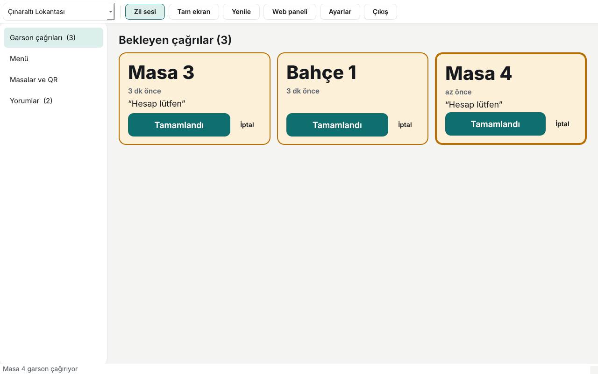
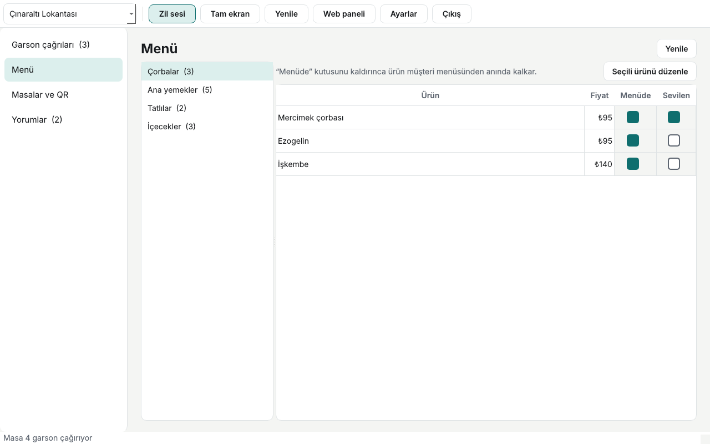
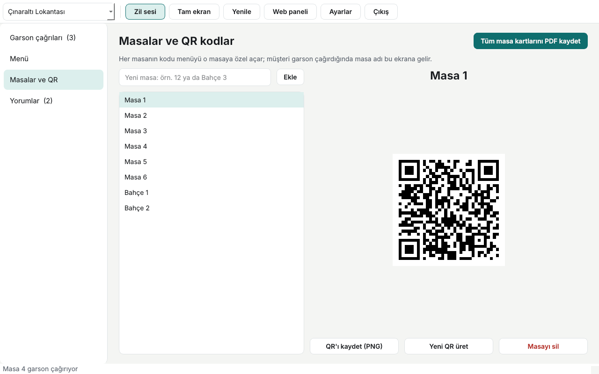
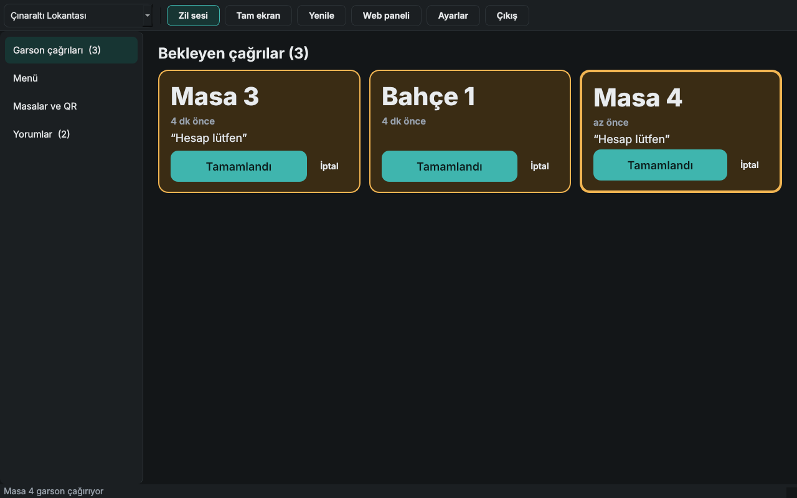

# QR Menü Çağrı Ekranı

[](https://github.com/melisayalcinkaya/qr-menu-desktop/actions/workflows/ci.yml)


[](LICENSE)

[QR Menü](https://github.com/melisayalcinkaya/qr_menus) için kasa ya da mutfak bilgisayarında çalışan masaüstü uygulaması. Müşteri masadaki QR koddan "Garson çağır"a bastığında, çağrı bu ekranda büyük bir kart olarak belirir; zil çalar ve bildirim gelir. Personel tek dokunuşla çağrıyı kapatır. Biten bir ürünü menüden gizlemek de tek tık.



## Neden ayrı bir masaüstü uygulaması?

Web paneli de çağrıları gösterir. Ancak bir tarayıcı sekmesi kasada gün boyu açık kalmaz: kapanır, arka planda kalır, ses izni ister. Bu uygulama:

- Pencere kapatılınca **sistem tepsisinde çalışmaya devam eder**; çağrı kaçmaz.
- Yeni çağrıda **zil sesi**, **masaüstü bildirimi** ve görev çubuğunda yanıp sönme verir.
- **Tam ekran (F11)** modunda uzaktan okunacak büyüklükte masa adları ve dokunmatik ekrana uygun düğmeler sunar.
- Oturumu işletim sisteminin **anahtar zincirinde** saklar; bilgisayar yeniden açıldığında doğrudan çağrı ekranına döner.

## Özellikler

- **Garson çağrıları:** En uzun bekleyen başta; yeni gelen kart vurgulanır. Kapatma iyimser (kart hemen kalkar, hata olursa geri gelir). Başka bir ekrandan kapatılmış çağrı sessizce düşer. Bağlantı koparsa görünür uyarı verir ve kendiliğinden yeniden dener.
- **Menü:** Kategoriye göre ürünler; "Menüde" kutusunu kaldırınca ürün müşteri menüsünden anında kalkar. Ad, fiyat, açıklama ve alerjen düzenleme.
- **Masalar ve QR:** Masa ekleme, QR önizleme ve PNG kaydetme, sızan bir kodu geçersiz kılmak için yeni kod üretme, tüm masa kartlarını tek PDF olarak kaydetme.
- **Yorumlar:** Onay bekleyenleri yayınlama, reddetme ve silme.
- Açık/koyu tema (sistem ayarını izler), birden fazla işletme arasında geçiş.

| Menü | Masalar ve QR | Koyu tema |
|---|---|---|
|  |  |  |

## Nasıl çalışır?

Uygulamanın kendi veritabanı yoktur; web paneliyle aynı [QR Menü API](https://github.com/melisayalcinkaya/qr_menus)'sini kullanır. Bu sayede menüde, masada ya da çağrıda yapılan her değişiklik web panelinde ve müşteri menüsünde anında görünür.

```
Müşteri telefonu ──QR──▶  QR Menü API  ◀──JWT── Bu uygulama (kasa / mutfak)
                           (Django)    ◀──JWT── Web paneli
```

- `api.py`: httpx ile API istemcisi. Erişim belirteci süresi dolunca kendiliğinden yenilenir.
- `tasks.py`: Ağ istekleri `QThreadPool`'da çalışır, sonuç Qt sinyaliyle arayüze döner; pencere hiç donmaz.
- `ui/calls.py`: Ayarlanabilir aralıkla (varsayılan 5 sn) çağrı yoklaması, yeni çağrı tespiti.
- `token_store.py`: Yenileme belirtecini Windows Kimlik Bilgisi Yöneticisi, macOS Anahtar Zinciri ya da Linux Secret Service'te saklar.

## Güvenlik

İlk sürüm (geçmişteki `first commit`) kendi SQLite dosyasını kullanıyordu: varsayılan `admin/admin123` hesabı oluşturuyor, şifreleri tuzsuz SHA-256 ile saklıyor ve QR kodları gerçek olmayan bir adrese yönlendiriyordu. Yeni sürümde:

| Konu | Yaklaşım |
|---|---|
| Şifreler | Uygulamada hiç saklanmaz; doğrulama sunucuda (Django, PBKDF2). Giriş sonrası şifre alanı bellekten temizlenir. |
| Oturum | Yalnızca yenileme belirteci saklanır, düz dosyada değil işletim sisteminin anahtar zincirinde. Her yenilemede değişir (rotasyon), çıkışta sunucuda kara listeye alınır. |
| Ağ | Yerel ağ dışındaki sunuculara yalnızca HTTPS ile bağlanılır; `http://` yalnızca `localhost` ve özel IP'lerde (geliştirme) kabul edilir. |
| Eşzamanlı yenileme | Yoklama ve kullanıcı işlemi aynı anda 401 alırsa tek bir yenileme yapılır (kilit); aksi halde rotasyon nedeniyle oturum düşerdi. Testi var. |
| Yetki | Tüm yetki kontrolleri sunucuda yapılır; uygulama yalnızca hesabın kendi işletmelerini görebilir. |

## Kurulum

### Hazır Windows uygulaması

[Releases](https://github.com/melisayalcinkaya/qr-menu-desktop/releases) sayfasından `QRMenuCagriEkrani.exe` dosyasını indirip çalıştırın. Kurulum gerekmez. Her `main` derlemesinin `.exe` dosyası, ilgili CI çalışmasının "Artifacts" bölümünde de bulunur.

### Kaynaktan

```bash
git clone https://github.com/melisayalcinkaya/qr-menu-desktop.git
cd qr-menu-desktop
python -m venv .venv && source .venv/bin/activate    # Windows: .venv\Scripts\activate
pip install -e ".[dev]"
python -m qrmenu_desktop
```

Giriş ekranında sunucu adresi varsayılan olarak canlı demodur (`https://qr-menus.onrender.com`). Demo hesabı: `demo` / `demo-sifre-2026`. Uygulamayı açıkken [Masa 4'ün menüsünden](https://qr-menus.onrender.com/m/cinaralti-lokantasi?masa=demo-klasik-4) garson çağırırsanız çağrı birkaç saniye içinde ekrana düşer.

Yerel geliştirme için [qr_menus](https://github.com/melisayalcinkaya/qr_menus) backend'ini çalıştırıp sunucu adresine `http://127.0.0.1:8000` yazabilirsiniz.

## Testler

```bash
pytest -q          # 29 test: API istemcisi, oturum saklama, çağrı panosu, menü, giriş
ruff check .
```

Arayüz testleri pytest-qt ile ekransız (`QT_QPA_PLATFORM=offscreen`) çalışır; HTTP istekleri respx ile taklit edilir. CI testleri Ubuntu ve Windows'ta çalıştırır, ardından PyInstaller ile tek dosyalık `.exe` üretip açıldığını doğrular. `v*` etiketiyle yapılan push'larda `.exe` otomatik olarak GitHub Release'e eklenir.

## Bilinen sınırlamalar

- Çağrılar yoklamayla (polling) gelir; en fazla seçilen aralık kadar (varsayılan 5 sn) gecikme olabilir. Sunucu Server-Sent Events desteklediğinde anlık bildirime geçilebilir.
- Yeni ürün, kategori ve işletme ekleme ile görsel yükleme web panelindedir ("Web paneli" düğmesi doğrudan açar). Bu uygulama günlük operasyona odaklanır.
- `.exe` dosyası imzalı olmadığı için Windows SmartScreen ilk açılışta uyarı gösterebilir.

## English summary

A desktop companion for the [QR Menu](https://github.com/melisayalcinkaya/qr_menus) web app, meant for the till or kitchen PC. Waiter calls from guests' phones appear as large tiles with a chime, a desktop notification and a flashing taskbar entry; staff close them with one tap. It also hides sold-out dishes, manages tables and QR codes (PNG and printable PDF) and moderates reviews.

Built with PySide6 and httpx as a client of the same REST API as the web panel; it has no database of its own. The refresh token lives in the OS keychain, plain HTTP is refused outside the local network, and concurrent token refreshes are serialised. The original version (first commit) was a standalone app with its own SQLite file and unsalted password hashes. CI lints and tests on Ubuntu and Windows, builds a one-file `.exe` with PyInstaller, smoke-runs it and attaches it to tagged releases.

## Lisans

[MIT](LICENSE). PySide6 LGPL lisanslıdır; bu yüzden MIT lisanslı bir uygulamada kullanılabilir (PyQt'nin GPL lisansı buna izin vermezdi).
